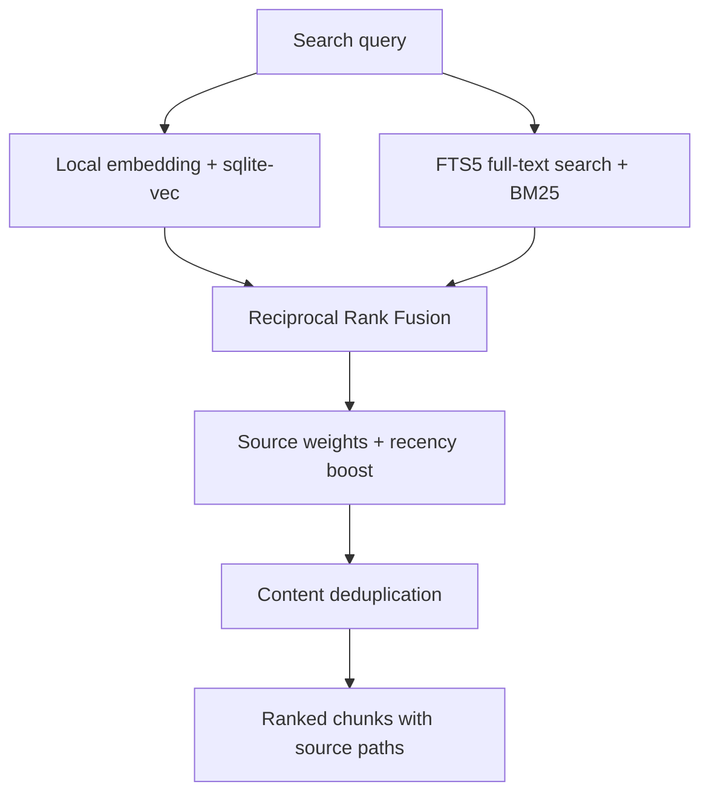

# kx — Knowledge indeX

> Local hybrid search for AI coding agents: turn your code, documentation, and notes into searchable project context.

[](https://github.com/distu/kx/actions/workflows/ci.yml)
[](LICENSE)
[](#connect-your-ai-agent)

**kx** is a local-first **Model Context Protocol (MCP) server and CLI** for semantic and keyword search across software projects. It combines embedding-based retrieval with BM25 full-text search, so AI agents can find both architectural concepts and exact identifiers before writing code.

Use it with **Claude Code, Codex, Cursor, or another stdio MCP client**, or search directly from your terminal. Retrieval runs on your machine using SQLite, sqlite-vec, FTS5, and Transformers.js. No hosted vector database, cloud inference API, or API key is required. The embedding model downloads on first use; indexing and search can then run offline with the model cached.

If you are building an AI coding workflow, a local retrieval-augmented generation (RAG) pipeline, or a searchable developer knowledge base, kx provides the retrieval layer. Your agent chooses when to call it and how to use the returned context.

[Quick start](#quick-start) · [MCP setup](#connect-your-ai-agent) · [CLI](#cli-reference) · [Contributing](#contributing)

## Why kx?

- **Hybrid retrieval:** semantic search finds related ideas; BM25 finds class names, configuration keys, and error messages. Reciprocal Rank Fusion (RRF) merges the rankings.
- **Local project context:** search Markdown docs, source code, configuration files, and personal notes without uploading the indexed corpus to a search service.
- **Separate project indexes:** each project defines its own sources and SQLite database in `.kx.json`. Optional per-call MCP identity checks help prevent accidental cross-project access.
- **Incremental updates:** index changed files on demand or keep the index current with a file watcher.
- **Useful results:** source paths, content snippets, type filters, recency weighting, and content deduplication help agents select relevant evidence.
- **Project continuity:** optional activity tracking and an artifact registry keep progress notes and published links in a local Markdown vault.
- **Small operational footprint:** embeddings run in-process; the core search workflow needs no separate model server or database service.

## Quick start

### 1. Install from source

Use Node.js 22 or later and npm. SQLite and ONNX dependencies include native components; some platforms may require compiler tools if a matching prebuilt binary is unavailable.

```bash
git clone https://github.com/distu/kx.git "$HOME/.kx"
cd "$HOME/.kx"
npm ci
npm run build
npm link
```

Choose another installation directory if `~/.kx` is already in use. `npm link` makes the `kx` command available; you can also run `node /absolute/path/to/kx/bin/kx.js` directly.

### 2. Configure a project

Create `.kx.json` in the root of the project you want to search:

```json
{
  "project": "my-project",
  "index": ".kx-data/index.sqlite",
  "sources": [
    { "type": "docs", "path": "docs", "glob": "**/*.md" },
    { "type": "code", "path": "src", "glob": "**/*.{java,ts,tsx,sql}" },
    { "type": "vault", "path": ".vault", "glob": "**/*.md" }
  ],
  "indexing": {
    "deny": [
      ".vault/private/**",
      "**/.env*",
      "**/*.key",
      "**/*.pem",
      "**/secrets/**"
    ]
  }
}
```

Keep only sources that exist in your project. Source paths and the index path are resolved relative to `.kx.json`; use an absolute path if you prefer storing the database elsewhere. Give each project a separate database path.

Keep local configuration, databases, and private notes out of version control. For example, add these entries to the project's `.gitignore`:

```gitignore
.kx.json
.mcp.json
.kx-data/
.vault/
```

### 3. Index and search

Run these commands from the configured project:

```bash
kx index
kx search "how does authentication work?" --top 5
kx search "SecurityConfig" --type code --top 3
kx status
```

The first indexing run downloads the embedding model. Later runs reuse the local cache. Use `kx watch` to reindex files as they change.

## Connect your AI agent

kx exposes tools over the MCP stdio transport. Configure your client to launch:

```bash
kx mcp --strict-project-root --project-root /absolute/path/to/project
```

The explicit root selects the project's `.kx.json`; strict mode rejects an implicit project root. If your client cannot find `kx` on its `PATH`, use `node` with the absolute path to `bin/kx.js` instead.

### Project identity checks

For new MCP integrations, generate a unique, non-secret UUID with `uuidgen` and add it to the project's existing `.kx.json`:

```json
{
  "mcp": {
    "projectId": "5b680e1f-92d5-4a47-8e33-fac913f65a71"
  }
}
```

The UUID above is an example; generate your own for each project. When `mcp.projectId` is configured, every MCP tool call must include:

- `expected_project_id`: the UUID read from the active project's `.kx.json`.
- `expected_project_root`: the absolute path to the active project root.

The server checks the UUID and canonical root before accessing project data. Missing or mismatched assertions return `KX_PROJECT_ASSERTION_REQUIRED` or `KX_PROJECT_MISMATCH`. Projects without `mcp.projectId` retain the legacy startup-based behavior for compatibility.

### Client configuration example

For clients that accept an `mcpServers` configuration, including a project-level Claude Code `.mcp.json`:

```json
{
  "mcpServers": {
    "kx": {
      "command": "kx",
      "args": [
        "mcp",
        "--strict-project-root",
        "--project-root",
        "/absolute/path/to/project"
      ]
    }
  }
}
```

Other MCP clients may use a different configuration format. Use the same executable and arguments in their MCP server settings.

### Give the agent a retrieval workflow

Add instructions like these to your project's agent instructions file:

```markdown
## Project context with kx

Before calling a KX MCP tool, read mcp.projectId from the active root's
.kx.json. Send it as expected_project_id and send the active absolute root
as expected_project_root on every call. Stop using the server instance if
it returns KX_PROJECT_MISMATCH.

Search project context before implementation, refactoring, architecture
questions, or code review. Start with 3–5 results and inspect the referenced
source files before making changes.

Use exact text or AST search for known symbols and precise line locations.
```

## How hybrid search works

Vector-only search can miss the exact strings developers need. kx combines two retrieval paths and merges their rankings:



Markdown is split around headings, code around function and class boundaries using heuristics, and configuration around file or section boundaries. Chunks are constrained to a conservative embedding token budget to reduce model truncation.

The default embedding model is `Xenova/all-MiniLM-L6-v2` with 384 dimensions. The default recency boost has a 90-day half-life and a maximum weight of 0.3. You can tune or disable it:

```json
{
  "search": {
    "recency": { "halfLifeDays": 90, "weight": 0.3 }
  }
}
```

Use `"recency": false` to disable the boost. A source can also define an optional `weight` greater than 1 to increase its priority.

### Reported benchmark

The existing synthetic stress benchmark uses the real indexing and search pipeline on Apple Silicon:

| Metric | Vector-only | Hybrid search |
| --- | --- | --- |
| Exact-identifier recall@10 | 3/20 | 20/20 |
| Warm query latency, p50 / p95 | — | 7 ms / 10 ms |
| Throughput with 8 workers | — | 142 searches/s |

These are measurements from the documented benchmark, not performance guarantees. Results depend on hardware, corpus, cache state, and configuration. Run `npm run stress` to evaluate your environment. The [search architecture notes](docs/ARQUITETURA-BUSCA.md) describe the original benchmark and retrieval design; that document is currently in Portuguese.

## CLI reference

```bash
# Hybrid search: natural language, exact terms, or JSON output
kx search "how are background jobs retried?"
kx search "SecurityConfig" --type code --top 3
kx search "authentication decision" --type vault
kx search "request timeout" --json

# Index maintenance
kx index                  # Incremental indexing
kx index --full           # Rebuild the index
kx status                 # Document and chunk counts by source type
kx vacuum                 # Compact the SQLite database
kx watch                  # Watch files and reindex changes

# MCP server
kx mcp --strict-project-root --project-root /absolute/path/to/project
```

Search types are `docs`, `code`, `config`, `vault`, and `all`. The legacy `kx mcp` command discovers configuration from the working directory and its parents, with a home-directory fallback.

### Published artifacts

The optional artifact registry records published pages, tracks versions, and links them to project activities:

```bash
kx artifact list
kx artifact list --atividade <activity-slug-or-id>
kx artifact add --url "https://example.com/demo" --titulo "Demo" --descricao "Architecture overview" --agente codex
kx artifact link --url "https://example.com/demo" --atividade <activity-slug-or-id>
```

The existing artifact flags and MCP parameter names retain their original Portuguese identifiers for API compatibility: `titulo` means title, `descricao` means description, `atividade` means activity, `agente` means agent, `arquivo` means source file, and `sessao` means session.

The human-readable registry is `.vault/ARTEFATOS.md`; structured records live in `.vault/artefatos/artefatos.json`. Other agents can register links through the CLI or MCP tools.

An optional Claude Code hook automatically registers successful publications from an `Artifact` tool. It requires kx at `~/.kx`, including `bin/kx-mcp.sh`. To install the hook:

```bash
mkdir -p "$HOME/.claude/hooks"
ln -s "$HOME/.kx/hooks/register-artifact.mjs" "$HOME/.claude/hooks/register-artifact.mjs"
```

Merge the following hook into your existing `~/.claude/settings.json`. Ensure `node` is available in the hook environment:

```json
{
  "hooks": {
    "PostToolUse": [
      {
        "matcher": "Artifact",
        "hooks": [
          {
            "type": "command",
            "command": "node ~/.claude/hooks/register-artifact.mjs",
            "timeout": 30
          }
        ]
      }
    ]
  }
}
```

The hook exits quietly outside a configured project. Registration errors are logged to `~/.kx/logs/artifact-hook.log` without failing the session.

## MCP tools

| Tool | Purpose |
| --- | --- |
| `search` | Hybrid search across indexed project content; accepts `query`, `top`, and `type`. |
| `ingest` | Index a file or directory admitted by the project's indexing policy. |
| `reindex` | Run a full or incremental project reindex. |
| `status` | Report index statistics. |
| `megabrain_add` | Create a project activity and update its Markdown index. |
| `megabrain_update` | Record progress, a blocker, or completion. |
| `megabrain_status` | List activities and their current status. |
| `megabrain_get` | Read an activity by slug or numeric ID. |
| `megabrain_artifact_add` | Register or version a published artifact. |
| `megabrain_artifacts` | List registered artifacts, optionally filtered by activity. |
| `megabrain_artifact_link` | Link an existing artifact to an activity. |

All tools require the project identity arguments when `mcp.projectId` is enabled. Existing `megabrain_*` tool names are retained for compatibility; they implement the KX activity manager and artifact registry.

## Local notes and project isolation

Each project owns its configuration, index, and optional `.vault/`. You can open the vault in Obsidian or maintain it with any Markdown editor. Typical folders include `architecture/`, `meetings/`, `decisions/`, `cheatsheets/`, and `_index/` for maps of content.

The kx executable can be shared across projects. Only the configured sources are indexed, and each project should point to a distinct SQLite file. Retrieved chunks are returned to the requesting MCP client; if that client uses a hosted AI model, its own data-handling settings determine where that context goes.

### Indexing policy

Built-in filters skip common dependency directories, nested worktrees, build outputs, binary files, media, and lockfiles. Explicitly configured source roots can change how directory exclusions apply.

`sources[].exclude` limits a source scan. Use the project-wide `indexing.deny` list when a path must also be blocked from individual ingestion and watcher updates. Deny patterns are glob paths relative to the project root, and the policy is opt-in. Indexing, search, and watcher operations reconcile the index so blocked paths stop appearing in results.

Deletion from SQLite is logical: old content may remain in free pages, WAL files, snapshots, or backups. If sensitive material was previously indexed, rotate any exposed credential, stop KX processes, remove the affected index and its `-wal`/`-shm` files, and rebuild from allowed sources. A denylist does not provide retroactive physical erasure.

### Memory and optional background services

The embedding model loads lazily. Each MCP process that performs a search keeps its own model instance, so memory use increases with concurrent clients. Use `KX_EMBEDDER_IDLE_UNLOAD_MINUTES` to opt into unloading the model after an idle interval.

`kx watch` runs in the foreground; use your operating system's service manager if you want it to run continuously. The optional KX Cockpit has a local HTTP daemon and a macOS SwiftUI client. See the [Cockpit documentation](docs/cockpit/README.md), currently in Portuguese, for its setup and scope.

## Technology

| Component | Implementation |
| --- | --- |
| Runtime | Node.js 22+ and TypeScript, executed with tsx |
| Storage | SQLite through better-sqlite3, with WAL mode |
| Vector retrieval | sqlite-vec |
| Keyword retrieval | SQLite FTS5 / BM25 |
| Ranking | Reciprocal Rank Fusion, source weights, recency boost, content deduplication |
| Embeddings | Transformers.js with a local ONNX model |
| Agent integration | Model Context Protocol SDK, stdio transport |
| CLI and file watching | Commander.js and Chokidar |
| Optional desktop client | SwiftUI on macOS |

## Contributing

Contributions are welcome, whether you use kx as an MCP server, a local RAG component, or a developer search tool.

Useful areas include retrieval evaluation, multilingual embeddings, chunking improvements, MCP client integration, platform compatibility, documentation translation, and reproducible performance benchmarks.

1. [Open an issue](https://github.com/distu/kx/issues) to report a bug or discuss a larger change. Include your Node.js version, operating system, and a minimal reproduction with synthetic or sanitized data.
2. Fork the repository and create a focused branch.
3. Install dependencies with `npm ci` and run the checks below.
4. Add regression tests for behavior changes and update the relevant documentation.
5. [Submit a pull request](https://github.com/distu/kx/pulls) explaining the problem, the resulting behavior, and how you verified it.

```bash
npm run typecheck
npm test
npm run build

# Optional: retrieval and throughput benchmark
npm run stress

# Optional: desktop client changes require macOS and Swift
swift build --package-path cockpit-app
```

Keep sample configurations generic. Do not include credentials, private project data, client names, local databases, or session transcripts in issues, tests, or pull requests. Some supporting documentation and existing CLI/tool identifiers are still in Portuguese; English documentation contributions are welcome.

## License

kx is available under the [MIT License](LICENSE).
